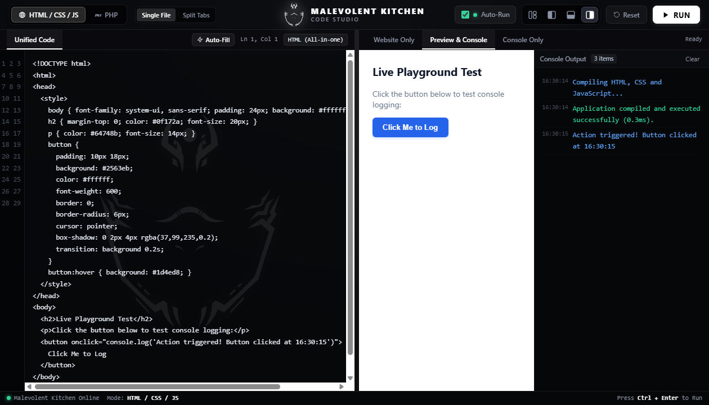
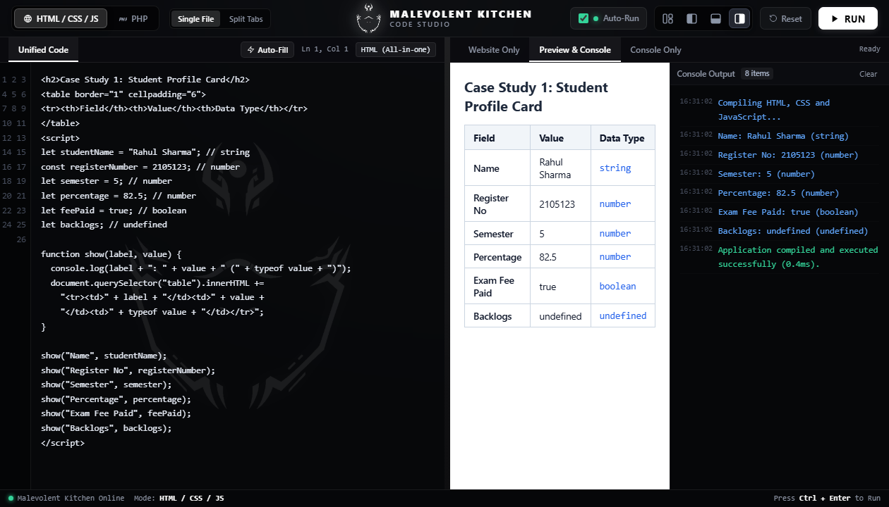
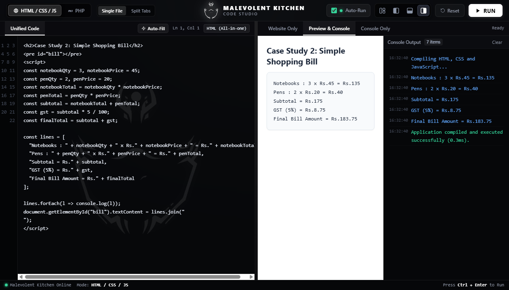
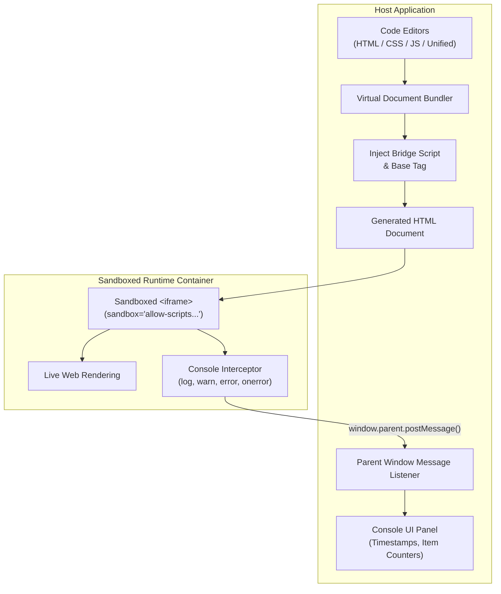

# Malevolent Kitchen

> A high-performance, client-side live code compiler and interactive web development playground.

[](https://developer.mozilla.org/en-US/docs/Web/HTML)
[](https://developer.mozilla.org/en-US/docs/Web/CSS)
[](https://developer.mozilla.org/en-US/docs/Web/JavaScript)
[](#system-architecture)
[](#license)

**Malevolent Kitchen** is an in-browser live code compilation engine and interactive web playground. Engineered with a zero-installation footprint, it allows developers, students, and educators to write, compile, execute, and debug web applications in real time. Code runs securely within an isolated execution container in the client browser, delivering instantaneous visual feedback and live console telemetry without requiring backend servers, package managers, or build pipelines.

---

## Table of Contents

- [Interface Preview](#interface-preview)
- [Key Features](#key-features)
- [Technology Stack](#technology-stack)
- [System Architecture](#system-architecture)
- [How It Works](#how-it-works)
- [Getting Started](#getting-started)
- [Usage Guide](#usage-guide)
- [Built-in Programming Examples](#built-in-programming-examples)
- [Project Structure](#project-structure)
- [Technical Implementation](#technical-implementation)
- [Security Considerations](#security-considerations)
- [Limitations](#limitations)
- [Future Enhancements](#future-enhancements)
- [Contributing](#contributing)
- [License](#license)

---

## Interface Preview

The application provides a focused, high-contrast workspace with split-pane editing, live visual rendering, and an interactive console streamer.

### Studio Workspace

*Figure 1: Main workspace displaying code editor with line telemetry, rendered output preview, and interactive console stream.*

### Execution & Verification
| Case Study 1: Student Profile Card | Case Study 2: Simple Shopping Bill |
| :---: | :---: |
|  |  |
| *Figure 2: Variable data types, dynamic DOM table generation, and runtime type introspection.* | *Figure 3: Numeric computation, expression evaluation, 5% GST calculation, and receipt rendering.* |

---

## Key Features

- **Multi-Mode Code Editor:** Toggle between **Split Tabs** (dedicated HTML, CSS, and JavaScript textareas) and a unified **Single File** document mode without losing code context.
- **Live Output Compilation:** Stitches markup, stylesheets, and logic on-the-fly to provide an instantaneous, real-time visual preview.
- **Sandboxed Execution Container:** Isolates executed code within a sandboxed `<iframe>` boundary to protect the host environment against unintended script mutations.
- **Real-Time Console Streamer:** Intercepts `console.log()`, `console.info()`, `console.warn()`, `console.error()`, and unhandled runtime exceptions, streaming them to a structured console with precise timestamps and log counters.
- **Debounced Automatic Execution:** Detects typing pauses and automatically recompiles code 500ms–650ms after input halts, eliminating manual compile cycles while preventing intermediate render jitter.
- **Workspace Layout Engine:** Dynamically reconfigures panels between **Output Right**, **Output Bottom**, **Output Left**, and **Split Screen** viewports.
- **Interactive Split Resizing:** Fine-tune workspace panel proportions using draggable divider bars.
- **Integrated Clipboard System:** Native toolbar buttons for Cut, Copy, and Paste operations that interact directly with editor selection ranges, alongside standard operating system shortcuts (`Ctrl+X`, `Ctrl+C`, `Ctrl+V`).
- **Productivity Snippets & Auto-Pairing:** Emmet-style expansion shortcuts (`!` + `Tab` for HTML5 boilerplate, `clg` + `Tab` for `console.log()`, `div` + `Tab`), automatic tag completion on `>`, and matching quote/bracket pairs (`()`, `[]`, `{}`).
- **Standalone JavaScript Scripting:** An asynchronous JavaScript execution runner with support for `console.table()` and object inspection.
- **Browser-Based PHP Transpiler:** A client-side transpile-execution engine supporting PHP variables, loops, arrays, `echo`, string concatenation, and mathematical operations directly in the browser.
- **State Persistence:** Automatically synchronizes code buffers, active language modes, output view choices, and layout states to `localStorage`.

---

## Technology Stack

| Component | Technology | Role |
| :--- | :--- | :--- |
| **Structure** | HTML5 | Semantic host UI layout and sandboxed `<iframe>` container. |
| **Styling** | CSS3 | Responsive Flexbox/Grid systems, dark theme tokens, line-number gutters, and glassmorphism headers. |
| **Engine** | JavaScript (ES6+) | Core bundler, state manager, debounce timers, async execution pipeline, and DOM APIs. |
| **Sandbox** | `iframe` + `srcdoc` | Isolated runtime sandbox executing user-generated web documents. |
| **Telemetry** | `postMessage` API | Cross-frame RPC communication bridge routing console logs from the child iframe to the host UI. |
| **Persistence** | `localStorage` API | Client-side cache synchronization for editor contents and layout configurations. |

---

## System Architecture

The following diagram illustrates the execution pipeline and the bidirectional console communication bridge:



### Execution Flow Details

1. **Source Code Aggregation:** Editor inputs are retrieved from either the active split tabs (`#editor-html`, `#editor-css`, `#editor-js`) or the single file editor (`#editor-unified`).
2. **Document Bundling:** The bundler formats the inputs into a compliant HTML5 document, embedding the CSS inside a `<style>` element and JavaScript inside a `<script>` element.
3. **Instrumentation Injection:** A client-side bridge script is prepended inside `<head>` to intercept standard `console` functions and route unhandled errors.
4. **Sandboxed Mounting:** The synthesized document is assigned to `previewFrame.srcdoc`, initiating fresh rendering within the browser's isolated iframe environment.
5. **Bidirectional RPC Logging:** Logs generated inside the child frame dispatch structured `{ malevolent: 1, type: t, msg: m }` payloads via `parent.postMessage()`, which the host listener catches and displays in the console viewer.

---

## How It Works

### Source Code Collection
When compilation is triggered, the engine determines the active mode:
- In **Single File Mode**, the entire document written in the unified textarea is gathered directly.
- In **Split Tabs Mode**, the engine reads the three separate buffers, escaping closing `</script>` and `</style>` tags to prevent premature HTML parser termination.

### Document Assembly
The engine combines the components into a standards-compliant document tree:
```javascript
htmlContent = '<!DOCTYPE html><html><head><meta charset="utf-8">' +
              '<style>' + css + '</style>' +
              baseTag + BRIDGE_SCRIPT +
              '</head><body>' + html +
              '<script>' + js + '<\/script></body></html>';
```

### Sandboxed Execution
The composite HTML document is mounted directly to the iframe via `srcdoc`:
```html
<iframe id="preview-frame" sandbox="allow-scripts allow-modals allow-forms allow-popups allow-same-origin"></iframe>
```
The sandbox flags restrict access to top-level navigation, external popups, and sensitive host APIs while permitting scripting, forms, and modal dialogs.

### Console Interception
To bridge output from the isolated frame back to the host interface, the injected instrumentation script proxies standard logging primitives:
```javascript
["log", "info", "warn", "error", "table", "dir"].forEach(function(k) {
  var orig = console[k];
  console[k] = function() {
    send(k, format(arguments));
    if (orig) orig.apply(console, arguments);
  };
});
```

---

## Getting Started

Because Malevolent Kitchen runs entirely on native browser technologies, **no server setup, npm packages, or build compilers are required**.

### Prerequisites
- Any modern web browser with ECMAScript 6+ support:
  - Google Chrome (version 90+)
  - Mozilla Firefox (version 88+)
  - Microsoft Edge (version 90+)
  - Apple Safari (version 14+)

### Installation & Launch

1. **Clone the repository:**
   ```bash
   git clone https://github.com/Shiva-Prasad-ai/malevolentKitchen.git
   ```

2. **Navigate to the project directory:**
   ```bash
   cd malevolentKitchen
   ```

3. **Open the application:**
   - Double-click `index.html` or open it with your preferred browser.
   - Alternatively, serve it locally using Python:
     ```bash
     python -m http.server 8000
     ```
     Then navigate to `http://localhost:8000` in your browser.

---

## Usage Guide

### Workspace Modes
- **Single File Mode:** Write unified HTML, CSS, and JS in a single document (ideal for rapid prototyping or loading existing templates).
- **Split Tabs Mode:** Maintain separation of concerns across dedicated **HTML**, **CSS**, and **JS** tabs.

### Compiling & Running
- **Manual Execution:** Click the **RUN** button in the header toolbar or press <kbd>Ctrl</kbd> + <kbd>Enter</kbd> (<kbd>Cmd</kbd> + <kbd>Enter</kbd> on macOS).
- **Auto-Run Mode:** Keep the **Auto-Run** checkbox enabled. The compiler will automatically execute code 650ms after typing halts.
- **Template Reset:** Click the **Reset** button to restore the editor buffer to the default starter template.

### Workspace Customization
- **Layout Switcher:** Click the layout icons in the top-right toolbar to toggle between:
  - Right Split (Code on left, output on right)
  - Bottom Split (Code on top, output on bottom)
  - Left Split (Code on right, output on left)
  - Full-screen Preview
- **Output View Selector:** Choose between:
  - **Website Only:** Hides the console to maximize the visual rendering viewport.
  - **Preview & Console:** Displays the live rendering and console output side-by-side.
  - **Console Only:** Maximizes the console panel for JavaScript/PHP debugging.

### Shortcuts & Productivity Snippets
| Trigger | Action | Target Tab |
| :--- | :--- | :--- |
| `!` + <kbd>Tab</kbd> or `html` + <kbd>Tab</kbd> | Inserts full HTML5 document boilerplate | HTML / Unified |
| `clg` + <kbd>Tab</kbd> or `log` + <kbd>Tab</kbd> | Inserts `console.log();` statement | JS / Unified |
| `fn` + <kbd>Tab</kbd> or `func` + <kbd>Tab</kbd> | Inserts a JavaScript function skeleton | JS / Unified |
| `div` + <kbd>Tab</kbd> | Inserts `<div></div>` container | HTML / Unified |
| `btn` + <kbd>Tab</kbd> | Inserts `<button></button>` element | HTML / Unified |
| `php` + <kbd>Tab</kbd> | Inserts `<?php ... ?>` block | PHP / Unified |
| `<tag>` + `>` | Automatically closes HTML tag with `</tag>` | HTML / Unified |
| `(`, `[`, `{`, `"`, `'` | Automatically inserts matching closing pair | All Editors |

---

## Built-in Programming Examples

Malevolent Kitchen includes verified reference implementations for standard web development algorithms and laboratory case studies:

### 1. Student Profile Card (Case Study 1)
- **Concepts:** Variable declarations (`let`, `const`), primitive and undefined data types, runtime data introspection (`typeof`), and dynamic DOM table creation.
- **Key Implementation:**
  ```javascript
  let studentName = "Rahul Sharma"; // string
  const registerNumber = 2105123;   // number
  let semester = 5;                // number
  let percentage = 82.5;           // number
  let feePaid = true;              // boolean
  let backlogs;                    // undefined

  function show(label, value) {
    console.log(label + ": " + value + " (" + typeof value + ")");
    document.querySelector("table").innerHTML +=
      "<tr><td>" + label + "</td><td>" + value + "</td><td>" + typeof value + "</td></tr>";
  }
  ```

### 2. Simple Shopping Bill (Case Study 2)
- **Concepts:** Arithmetic operators (`*`, `+`, `/`), compound expression evaluation, dynamic 5% Goods and Services Tax (GST) calculation, and receipt formatting.
- **Key Implementation:**
  ```javascript
  const notebookQty = 3, notebookPrice = 45;
  const penQty = 2, penPrice = 20;

  const notebookTotal = notebookQty * notebookPrice; // Rs. 135
  const penTotal = penQty * penPrice;               // Rs. 40
  const subtotal = notebookTotal + penTotal;         // Rs. 175
  const gst = (subtotal * 5) / 100;                  // Rs. 8.75
  const finalTotal = subtotal + gst;                 // Rs. 183.75
  ```

---

## Project Structure

The repository contains the following structure:

```
malevolentKitchen/
├── .nojekyll                            # Disables Jekyll processing for GitHub Pages hosting
├── favicon.ico                          # Application shortcut icon
├── favicon.png                          # High-resolution application icon
├── fig1_compiler_interface.png          # Studio interface preview screenshot
├── fig2_source_code_part1.png           # Source code documentation screenshot (Lines 1-40)
├── fig3_source_code_part2.png           # Source code documentation screenshot (Lines 41-79)
├── fig4_case_study_1.png                # Case Study 1 execution screenshot
├── fig5_case_study_2.png                # Case Study 2 execution screenshot
├── index.html                           # Primary entry point (Core Studio Application)
├── Malevolent_Kitchen_Compiler_Report.pdf # Publication-ready comprehensive project documentation
├── README.md                            # Technical repository documentation
├── report.html                          # Complete HTML source for the academic report
├── sukuna.png                           # Studio visual asset
├── sukuna_clean.png                     # Primary studio branding emblem
└── Web Playground.html                  # Standalone offline backup document
```

---

## Technical Implementation

### Virtual Document Bundler
The bundler operates in `compileAndRunWeb()`. When in split mode, it reads raw strings from the HTML, CSS, and JS textareas. It dynamically appends a `<base href="...">` tag to preserve relative asset loading paths for assets in the same directory (such as icons and images).

### Iframe Sandbox Boundary
The output viewport is isolated with:
```html
<iframe id="preview-frame" sandbox="allow-scripts allow-modals allow-forms allow-popups allow-same-origin"></iframe>
```
This configuration permits scripts to execute and send cross-window messages while restricting top-level navigation attacks, window hijacking, and unauthorized local resource access.

### Cross-Window PostMessage RPC Bridge
The host application registers an event listener:
```javascript
window.addEventListener("message", function(e) {
  var d = e.data;
  if (!d || d.malevolent !== 1) return;
  appendLog(d.type === "error" || d.type === "e" ? "e" : d.type === "warn" || d.type === "w" ? "w" : "i", d.msg);
});
```
The payload envelope contains a signature key (`malevolent: 1`) to ensure non-studio messages are safely filtered out.

### Debounce Mechanism
Keystrokes trigger `scheduleAutoRun()`:
```javascript
function scheduleAutoRun() {
  if (autoRunEnabled) {
    clearTimeout(autoRunTimer);
    autoRunTimer = setTimeout(function() {
      executeCode();
    }, 650);
  }
}
```
This debounces execution until the user has stopped typing for 650ms, maintaining 60 FPS typing performance and avoiding unnecessary DOM redraws.

### LocalStorage Persistence
The application serializes editor contents and UI states under a single versioned key (`malevolent_kitchen_clean_v7`):
- `lang`: Active language selection (`web`, `js`, `php`).
- `webMode`: Mode selection (`single`, `split`).
- `layout`: Active layout preset (`right`, `bottom`, `left`, `split`).
- `outputDisplayMode`: Selected view (`preview`, `both`, `console`).
- `autoRunEnabled`: Boolean state for automated execution.
- Code buffers for HTML, CSS, JS, standalone JS, and PHP.

---

## Security Considerations

While Malevolent Kitchen implements sandboxing protections, client-side code execution carries inherent architectural constraints:

1. **Sandboxing Limitations:** The iframe uses `sandbox="allow-scripts allow-same-origin"`. This allows user scripts to access local storage and execute code under the document's origin. Malicious infinite loops (e.g., `while(true){}`) will lock the browser thread.
2. **PostMessage Origin Validation:** The parent listener validates incoming message structure (`d.malevolent === 1`). In high-security multi-user deployments, origin validation (`e.origin`) should be configured against an isolated sandbox domain.
3. **Client-Side Transpilation:** The PHP transpiler parses script tokens and executes transpiled JavaScript via `new Function()`. It is designed strictly for safe, local algorithmic experimentation and should not be used to process untrusted server payloads.

---

## Limitations

- **Browser Dependency:** Code execution performance and memory limits are strictly bound to the client browser's JavaScript engine (V8, SpiderMonkey, or JavaScriptCore).
- **Client-Side PHP Scope:** The built-in PHP engine is a lightweight, zero-dependency client-side transpiler. It supports standard control structures, variable assignments, arrays, arithmetic expressions, and common string/array functions (`count`, `explode`, `implode`, `strtoupper`, `json_encode`). It does **not** emulate the full PHP standard library, database extensions (`pdo`, `mysqli`), or server-side socket APIs.
- **Network Restrictions:** Because the application is client-side, outgoing network requests (`fetch()`, `XMLHttpRequest`) made within the sandboxed iframe are subject to standard browser Cross-Origin Resource Sharing (CORS) policies.

---

## Future Enhancements

- [ ] **Advanced Code Editor Integration:** Migration to Monaco Editor or CodeMirror 6 for syntax highlighting, multi-cursor support, and fold gutters.
- [ ] **Language Expansions:** Client-side Python execution via Pyodide (WebAssembly) and TypeScript transpilation via Babel/TypeScript compiler.
- [ ] **Project Bundling & Export:** Export projects as standalone `.zip` archives containing organized `index.html`, `style.css`, and `script.js` files.
- [ ] **Console Filter Controls:** Log level filtering (verbose, info, warnings, errors) and regex search filtering.
- [ ] **Worker Isolation:** Offloading script execution to Web Workers to prevent long-running tasks from freezing the primary UI thread.

---

## Contributing

Contributions, bug reports, and feature requests are welcome. To contribute:

1. Fork the repository.
2. Create your feature branch:
   ```bash
   git checkout -b feature/enhancement-name
   ```
3. Commit your changes:
   ```bash
   git commit -m "feat: implement enhanced telemetry logging"
   ```
4. Push to the branch:
   ```bash
   git push origin feature/enhancement-name
   ```
5. Open a Pull Request detailing your changes.

---

## License

This project is licensed under the terms specified by the repository maintainer. Refer to the repository license or contact the maintainer for redistribution and reuse terms.
